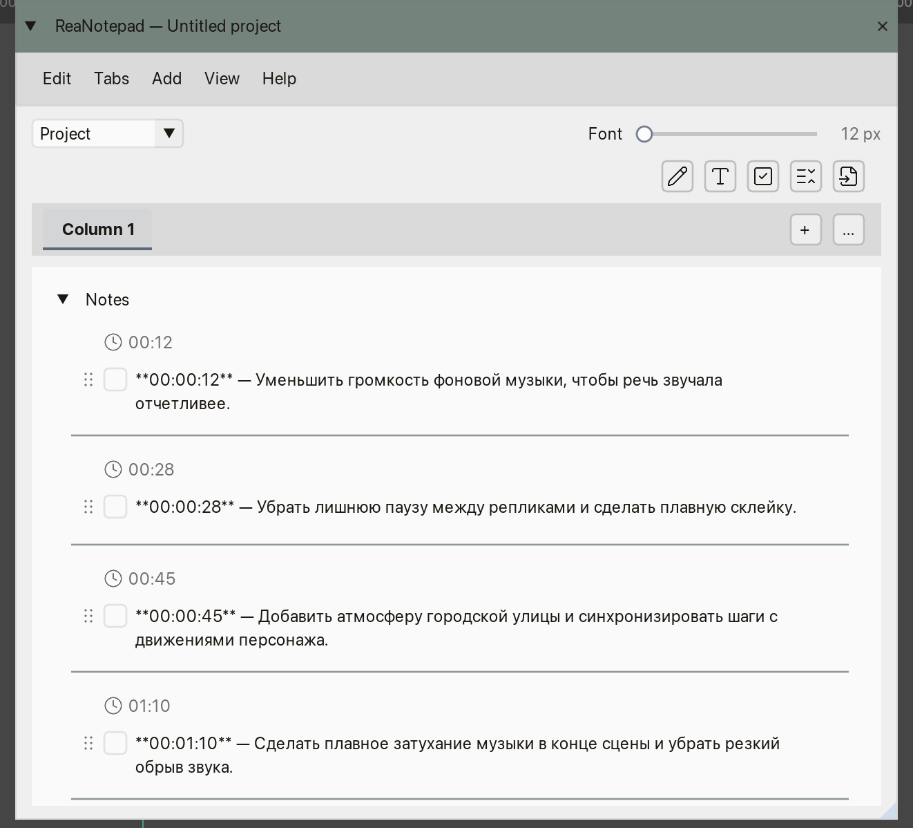

# ReaNotepad

**English** · [Русский](README_RU.md)

ReaNotepad is a structured notes editor for REAPER projects, tracks and media items. Keep edit lists, tasks, production notes and status fields in one window. Each document has horizontal tabs containing collapsible groups of notes. Notes are stored in the REAPER project rather than separate working files.



## Requirements

| Component | Version |
| --- | --- |
| REAPER | 7 or later |
| ReaImGui | 0.10 or later |

Install ReaImGui through [ReaPack](https://reapack.com/). SWS is not required.

## Installation

1. Install ReaImGui through ReaPack.
2. Download `ReaNotepad.lua` from the release and place it in your REAPER `Scripts` folder. Find the resource folder via **Options → Show REAPER resource path in explorer/finder**.
3. Open **Actions → Show action list** and select the **Main** section.
4. Choose **New action → Load ReaScript**, select `ReaNotepad.lua`, then run the registered action.

ReaNotepad is also maintained in the [Patch34 Scripts ReaPack repository](https://raw.githubusercontent.com/patch-34/patch34-reapack/main/index.xml). Its index is updated separately from this GitHub repository, so the version shown in ReaPack may differ temporarily.

## Updating

Replace the existing `ReaNotepad.lua` in the same location. Keep that filename unchanged to retain REAPER action IDs, shortcuts and toolbar assignments. You do not need to register the action again. Save a backup of important REAPER projects before editing them in a new major document format.

## Documents and storage

Use the owner selector at the top to switch between three scopes:

| Scope | Owner | Storage |
| --- | --- | --- |
| Project | Current REAPER project | Native project notes |
| Track | One selected track, including the master track | Track extension data in the `.rpp` project |
| Item | One selected media item | Native item notes |

In Track and Item modes, the editor follows the selection in REAPER and requires exactly one selected track or item. Every owner has its own tabs, groups and session Undo/Redo history. Changes are written into the open project; **save the REAPER project** to make them persistent on disk.

Existing plain-text notes are imported into the document without changing their native contents until the first edit.

## Tabs, groups and notes

A document has up to eight **horizontal tabs**. Each tab contains **vertical groups** with their own heading, disclosure arrow and notes. Only the active tab is shown.

| Action | How to do it |
| --- | --- |
| Create a tab | **Tabs → New tab** or the **+** beside the tab strip |
| Switch tabs | Click a tab or choose it in the **Tabs** menu |
| Reorder tabs | Drag tabs left or right, or use their context menu |
| Rename a tab | Double-click its title, or use its context menu |
| Delete a tab | Right-click the tab → **Delete tab…** (the last tab cannot be deleted) |
| Create a group | **Add → New group**, the top toolbar's group icon, or **New group below** in a group menu |
| Collapse/expand a group | Click its disclosure arrow |
| Rename, reorder or delete a group | Open its **…** menu; double-click its title to rename |
| Color a group heading | Group **… → Group header color** |

A group can contain multiline text notes, notes with completion checkboxes, and named dropdown fields with editable choices. Hover over the icons in the top toolbar for tooltips. To create an element, **drag its icon onto a group**, or **click the icon and then choose a group**; Esc cancels placement. The **Add** menu also creates notes in the active group. Import opens a separate dialog.

Drag a note by the grip at its left edge to reorder it or move it into another group or tab. During a drag, the top toolbar displays a trash target for deletion. Individual note menus also offer **Move up**, **Move down**, **Move to group**, **Color marker** and **Delete…**.

### Editing text and dropdowns

Click a text note to edit it in place. **Enter** applies the edit, **Shift+Enter** inserts a line break, and clicking outside applies the edit. **Esc** asks for confirmation before discarding changed text. Read-mode text wraps visually without changing the saved line breaks.

Click a checkbox to mark a note complete. Select a dropdown value directly from its menu. Click a dropdown's name to reveal **Edit…** beside it, or use **… → Edit field…**, to change its name, options, order and current value. An individual note edit is one Undo step.

## Multiple selection

Open a group's **… → Select elements…** command, then click notes to select or deselect them. The selection toolbar provides **All / Clear selection**, **Color…**, **Delete…** and **Done**. Deletion asks for confirmation; bulk color changes and deletions each form one Undo step.

Only visible notes can be selected. Leaving selection mode, switching tabs or note owners, and Undo/Redo clear the selection. Esc exits selection mode, unless a confirmation dialog is open.

## Color markers

Use a note's **Color marker** menu or the selection toolbar's **Color…** action. Available colors are red, orange, yellow, green, blue and purple; **No marker** removes the color. In **View → Color marker style**, choose a left strip or a subtle whole-note background tint. Group heading colors are set independently in the group's menu.

Marker changes are stored with the document and support Undo/Redo. Changing the global display style does not change document contents.

## Text import and timecodes

Open **Edit → Import text…**, use **Add → Import text…**, or choose the import icon in the toolbar and select the destination group.

1. Select a destination group in the dialog.
2. Paste the source text in the left pane and inspect the right-hand preview.
3. Set **Remove numbering** and **Recognize timecodes** as needed.
4. Click **Import**. All imported entries are added as unchecked checkbox notes in a single Undo step.

Blank lines separate paragraphs; numbered entries can include continuation lines. Without blank lines or numbering, each nonempty line is a separate note. Numbering such as `1.`, `2)`, `(3)`, `[4]`, `5:`, `6 —` and `1.2.` is recognized; isolated years and ambiguous numbers are handled conservatively.

When **Recognize timecodes** is enabled, a timecode at the **start** of a note can appear above it with a clock icon:

| Example | Meaning |
| --- | --- |
| `01:45` | 1 minute, 45 seconds (`MM:SS`) |
| `00:00:12` | 12 seconds (`HH:MM:SS`) |
| `00:01:35:04` | 1 minute, 35 seconds, 4 frames (`HH:MM:SS:FF`) |
| `00:01:35.250` | 1 minute, 35.250 seconds (milliseconds) |

The four-part format uses the current REAPER project's frame rate and supports its drop-frame mode. Frame numbers outside the project's valid range are not recognized. **Double-click the clock/timecode indicator** to seek to that ruler time, including the project's start-time offset. The original timecode text stays in the note. Unchecking **Recognize timecodes** disables timecode badges for the corresponding imported entries; manually created and older notes may be detected automatically.

## View, spacing and language

| Setting | Function |
| --- | --- |
| **View → Hide completed** | Hide completed checkbox notes without deleting them |
| **View → Completed notes last** | Show completed notes at the end of each group (display order only) |
| **View → Color marker style** | Left strip or whole-note tint |
| **View → Note spacing** | Adjust the gap above and below note separators from 0 to 24 px; default **5 px**; **Reset spacing** restores the default |
| **View → Pages / REAPER Grey / Google Docs White / Dark** | Select the interface theme |
| **View → Language** | English or Russian interface |
| **Font** slider | Note text size, 12–32 px, independently of the interface font; double-click the slider to reset it to 16 px |
| **Dock to docker** | Dock/undock through the window's context menu |

View preferences are saved between runs and do not create document Undo entries. The **Help** menu opens this README or the Russian README according to the selected interface language.

## Undo and Redo

| Action | Windows / Linux | macOS |
| --- | --- | --- |
| Undo | Ctrl+Z | Cmd+Z |
| Redo | Ctrl+Shift+Z or Ctrl+Y | Cmd+Shift+Z or Cmd+Y |

Undo/Redo covers text edits, completion states, dropdowns, imports, colors, group/tab changes, note moves and recovery restoration. It is independent for each note owner and is kept for the current script session. Histories are capped at 100 entries or approximately 16 MiB per stack; related typing is grouped using a short time interval. History resets on script restart or when external edits replace the loaded document.

## Recovery and format compatibility

Invalid or unsupported structured notes open read-only instead of being silently overwritten. Conflicts with native notes stop automatic writing. Recovery copies may contain the original notes, an in-memory draft, attempted writes, pending dialog text and a diagnostic report.

Recovery directory:

```text
<REAPER resource directory>/Data/Patch34_Project_Notes_Recovery/
```

To restore, choose **Edit → Open recovery copy…**, inspect the selected `.notes` file in the preview and select **Restore**. Restoration supports Undo/Redo. Recovery copies can reflect incomplete operations, so review them first.

**ReaNotepad 0.6.0 writes document format v3**, with optional group header colors and imported timecode flags. Existing v1/v2 structured documents and plain-text notes remain readable. Opening an older document alone does not rewrite it, but edits save in the current format. Older script releases may not be able to edit documents saved by v0.6.0. Internal `Patch34` format headers, track-extension keys, preference keys and recovery paths are retained for compatibility.

## License and credits

Author: [Aleksei Vorobev / Patch34](https://github.com/patch-34).

ReaNotepad is released under the [MIT License](LICENSE). The interface uses [ReaImGui](https://github.com/cfillion/reaimgui); icons are from [Lucide](https://lucide.dev/). Third-party icon notices are included in [LUCIDE_LICENSE.txt](docs/licenses/LUCIDE_LICENSE.txt).
