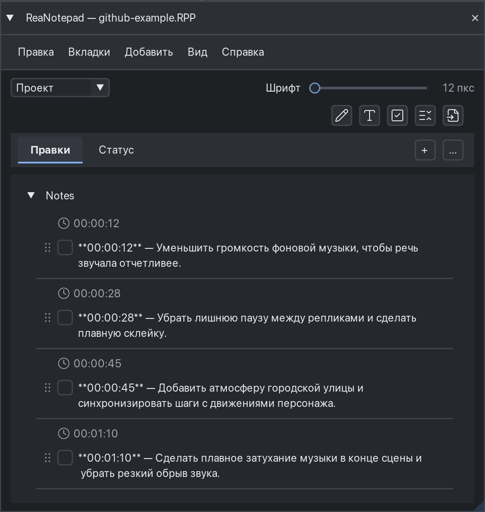

# ReaNotepad

[English](README.md) · **Русский**

ReaNotepad — редактор структурированных заметок для проектов, дорожек и айтемов REAPER. Он подходит для списков правок, задач, рабочих заметок и статусов. Документ состоит из горизонтальных вкладок, внутри которых находятся сворачиваемые группы заметок. Данные хранятся в проекте REAPER, без отдельных рабочих файлов.



## Требования

| Компонент | Версия |
| --- | --- |
| REAPER | 7 или новее |
| ReaImGui | 0.10 или новее |

ReaImGui устанавливается через [ReaPack](https://reapack.com/). SWS не требуется.

## Установка

1. Установи ReaImGui через ReaPack.
2. Скачай `ReaNotepad.lua` из релиза и помести его в папку `Scripts` каталога ресурсов REAPER. Путь к каталогу можно открыть через **Options → Show REAPER resource path in explorer/finder**.
3. Открой **Actions → Show action list** и выбери раздел **Main**.
4. Нажми **New action → Load ReaScript**, укажи `ReaNotepad.lua` и запусти добавленное действие.

ReaNotepad также поддерживается в личном каталоге [Patch34 Scripts для ReaPack](https://raw.githubusercontent.com/patch-34/patch34-reapack/main/index.xml). Его индекс обновляется отдельно от GitHub-репозитория, поэтому версия в ReaPack некоторое время может отличаться.

## Обновление

Замени прежний `ReaNotepad.lua` по тому же пути. Не переименовывай файл: это позволяет сохранить идентификатор действия в REAPER, назначенные горячие клавиши и кнопки панелей. Регистрировать действие повторно не нужно. Перед переходом на новую основную версию формата полезно сохранить резервную копию важных проектов REAPER.

## Документы и хранение

Переключатель владельца заметок расположен в верхней панели:

| Режим | Владелец | Хранение |
| --- | --- | --- |
| Проект | Текущий проект REAPER | Стандартные заметки проекта |
| Дорожка | Одна выделенная дорожка, включая мастер-дорожку | Дополнительные данные дорожки в `.rpp` |
| Айтем | Один выделенный айтем | Стандартные заметки айтема |

В режимах «Дорожка» и «Айтем» окно следует за выделением в REAPER; нужно выделить ровно одну дорожку или один айтем. У каждого владельца свой документ и независимая история отмены и повтора в рамках сеанса. Изменения записываются в открытый проект — **сохрани проект REAPER**, чтобы они остались на диске.

Обычные текстовые заметки подхватываются без изменения исходного содержимого до первой правки.

## Вкладки, группы и заметки

Документ поддерживает до восьми **горизонтальных вкладок**. В каждой вкладке находятся **вертикальные группы** с заголовками, стрелками сворачивания и заметками. На экране отображается только активная вкладка.

| Действие | Как выполнить |
| --- | --- |
| Создать вкладку | **Вкладки → Новая вкладка** или кнопка **+** рядом с вкладками |
| Перейти во вкладку | Нажать на неё или выбрать в меню **Вкладки** |
| Изменить порядок вкладок | Перетащить мышкой либо воспользоваться контекстным меню |
| Переименовать вкладку | Дважды щёлкнуть по названию либо открыть её контекстное меню |
| Удалить вкладку | Правый щелчок → **Удалить вкладку…** (последняя вкладка не удаляется) |
| Создать группу | **Добавить → Новая группа**, значок группы в панели или **Новая группа ниже** в меню группы |
| Свернуть/развернуть группу | Нажать на стрелку у заголовка |
| Переименовать, передвинуть или удалить группу | Открыть меню **…**; двойной щелчок по названию тоже переименовывает группу |
| Изменить цвет заголовка группы | **… → Цвет заголовка группы** |

В группу можно добавлять многострочный текст, заметки с чекбоксом и именованные выпадающие списки. Значки в верхней панели снабжены подсказками. Чтобы создать элемент, **перетащи его значок на группу** или **нажми значок, затем выбери группу**. Esc отменяет размещение. Меню **Добавить** также создаёт заметки в активной группе. Для импорта открывается отдельный диалог.

Заметку можно перетащить за ручку слева, чтобы изменить её положение или переместить в другую группу либо вкладку. Во время перетаскивания в верхней панели появляется корзина для удаления. Меню отдельной заметки содержит команды **Выше**, **Ниже**, **В другую группу**, **Цветовая метка** и **Удалить…**.

### Редактирование заметок и списков

Нажми на текст заметки, чтобы отредактировать его прямо на месте. **Enter** применяет изменения, **Shift+Enter** вставляет перенос строки, щелчок снаружи также применяет изменения. **Esc** предлагает подтвердить отмену, если текст изменён. В режиме чтения перенос строк не меняет сохранённый текст.

Нажатие на чекбокс переключает статус выполнения. Значение выпадающего списка можно выбрать прямо в нём. Чтобы изменить название, варианты, их порядок и текущее значение, нажми на название списка — рядом появится кнопка **Изменить…** — или выбери **… → Изменить поле…**. Правка одной заметки является одним шагом истории Undo.

## Выделение нескольких заметок

В меню группы **… → Выделить элементы…** включи выделение и нажми на нужные заметки. Повторный щелчок снимает выделение. В панели доступны **Все / Снять**, **Цвет…**, **Удалить…** и **Готово**. Удаление запрашивает подтверждение; массовая перекраска или удаление выполняются одним шагом Undo.

Выделяются только видимые заметки. Выход из режима выделения, смена вкладки или владельца и Undo/Redo сбрасывают выделение. Esc закрывает режим выделения, а при открытом окне подтверждения сначала отменяет его.

## Цветовые метки

Цвет отдельной заметки меняется через меню **Цветовая метка**, нескольких заметок — через **Цвет…** на панели выделения. Доступны красная, оранжевая, жёлтая, зелёная, синяя и фиолетовая метки; **Без метки** удаляет цвет. В меню **Вид → Оформление цветовых меток** можно выбрать полоску слева или мягкую заливку всей заметки. Цвет заголовка группы задаётся отдельно в её меню.

Цвета сохраняются в документе и поддерживают Undo/Redo. Изменение общего оформления не меняет данные заметок.

## Импорт текста и таймкоды

Открой **Правка → Импорт текста…**, **Добавить → Импорт текста…** либо нажми значок импорта в верхней панели и выбери группу.

1. Выбери группу назначения в диалоге.
2. Вставь исходный текст слева и проверь предпросмотр справа.
3. При необходимости включи или отключи **Удалять нумерацию** и **Разделять по таймкодам**.
4. Нажми **Импорт**. Все записи добавятся как невыполненные заметки с чекбоксами за один шаг Undo.

Пустые строки разделяют абзацы, а нумерованные пункты могут содержать строки продолжения. Без пустых строк и нумерации каждая непустая строка образует отдельную заметку. Распознаются `1.`, `2)`, `(3)`, `[4]`, `5:`, `6 —` и `1.2.`. Неоднозначные числа и годы не удаляются без достаточных признаков списка.

Опция **Разделять по таймкодам** создаёт отдельную импортированную заметку для каждого распознанного таймкода в начале строки. Независимо от этой настройки таймкоды **в начале** любых заметок распознаются автоматически и отображаются со значком часов:

| Пример | Значение |
| --- | --- |
| `01:45` | 1 минута 45 секунд (`ММ:СС`) |
| `00:00:12` | 12 секунд (`ЧЧ:ММ:СС`) |
| `00:01:35:04` | 1 минута 35 секунд и 4 кадра (`ЧЧ:ММ:СС:КК`) |
| `00:01:35.250` | 1 минута 35,250 секунды (миллисекунды) |

Формат с четырьмя полями использует частоту кадров текущего проекта REAPER, включая drop-frame. Недопустимые номера кадров не распознаются. **Двойной щелчок по значку часов или таймкоду** перемещает курсор к соответствующему времени линейки с учётом стартового смещения проекта. Исходная запись таймкода остаётся в заметке. Настройка разделения не отключает значки часов и переход по таймкодам, в том числе у заметок, импортированных старыми версиями.

## Вид, интервалы и язык

| Настройка | Назначение |
| --- | --- |
| **Вид → Скрыть выполненные** | Скрывает выполненные заметки, не удаляя их |
| **Вид → Выполненные в конце** | Показывает выполненные заметки в конце каждой группы (без изменения порядка хранения) |
| **Вид → Оформление цветовых меток** | Полоска слева или заливка заметки |
| **Вид → Интервал между заметками** | Зазор с каждой стороны сепаратора от 0 до 24 px; по умолчанию **5 px**; **Сбросить интервал** возвращает исходное значение |
| **Вид → Pages / REAPER Grey / Google Docs White / Тёмная** | Выбор оформления интерфейса |
| **Вид → Язык** | Английский или русский интерфейс |
| Ползунок **Шрифт** | Размер текста заметок от 12 до 32 пкс, отдельно от шрифта интерфейса; двойной щелчок по ползунку возвращает 16 пкс |
| **Закрепить в докере** | Закрепление или открепление окна через контекстное меню окна |

Настройки вида сохраняются между запусками и не создают шагов Undo. Меню **Справка** открывает английский или русский README в зависимости от языка интерфейса.

## Отмена и повтор

| Действие | Windows / Linux | macOS |
| --- | --- | --- |
| Отмена | Ctrl+Z | Cmd+Z |
| Повтор | Ctrl+Shift+Z или Ctrl+Y | Cmd+Shift+Z или Cmd+Y |

История включает правки текста, отметки выполнения, значения списков, импорт, цвета, операции с группами и вкладками, перенос заметок и восстановление копий. Для каждого владельца история отдельная и действует в течение сеанса скрипта. Каждый стек ограничен 100 записями или примерно 16 МиБ; последовательный набор текста объединяется с небольшой паузой. Перезапуск скрипта или подмена документа внешней правкой сбрасывает историю.

## Восстановление и совместимость формата

Повреждённые или неподдерживаемые структурированные заметки открываются только для чтения и не перезаписываются автоматически. При конфликте с нативными заметками запись останавливается. Аварийные копии могут включать исходный текст, локальный черновик, попытку записи, неприменённое содержимое диалога и диагностический отчёт.

Каталог копий:

```text
<каталог ресурсов REAPER>/Data/Patch34_Project_Notes_Recovery/
```

Для восстановления выбери **Правка → Открыть аварийную копию…**, проверь `.notes` в предпросмотре и нажми **Восстановить**. Действие поддерживает Undo/Redo. Копия может содержать незавершённую операцию, поэтому перед восстановлением проверь её содержимое.

**ReaNotepad 0.6.1 записывает документы в формате v3** с необязательными цветами групп и сохранёнными метаданными таймкодов. Структурированные документы v1/v2 и обычные текстовые заметки по-прежнему читаются. Простое открытие старого документа не изменяет его, но первая правка сохраняет данные в новом формате. Предыдущие версии скрипта могут не редактировать документы, сохранённые в 0.6.1. Внутренние заголовки формата, ключи хранения Patch34, настройки и путь аварийных копий оставлены без изменения ради совместимости.

## Лицензия и авторство

Автор: [Aleksei Vorobev / Patch34](https://github.com/patch-34).

ReaNotepad распространяется по [лицензии MIT](LICENSE). Интерфейс использует [ReaImGui](https://github.com/cfillion/reaimgui), значки — [Lucide](https://lucide.dev/). Лицензии сторонних значков находятся в [LUCIDE_LICENSE.txt](docs/licenses/LUCIDE_LICENSE.txt).
