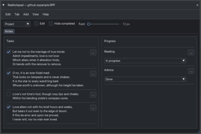

# ReaNotepad

[English](README.md) · **Русский**

**Версия 0.5.0** · Lua-скрипт для REAPER. Автор — Aleksei Vorobev / Patch34.

Заметки к проектам, дорожкам и айтемам REAPER с вкладками и колонками изменяемой ширины. Можно добавлять текст, многострочные заметки с чекбоксами и поля с редактируемыми выпадающими списками. Заметки хранятся вместе с проектом REAPER. Прежнее название скрипта — Patch34 Project Notes.

## Требования и установка

- REAPER 7 или новее.
- ReaImGui 0.10 или новее — устанавливается через [ReaPack](https://reapack.com/).

SWS не требуется. Для работы нужен один Lua-файл.

1. Установи ReaImGui через ReaPack. Перезапусти REAPER, если он попросит.
2. Распакуй архив и скопируй `ReaNotepad_v0.5.0.lua` в постоянную папку, например `Scripts` в каталоге ресурсов REAPER. Открыть каталог можно через **Options → Show REAPER resource path in explorer/finder**.
3. Открой **Actions → Show action list**, выбери раздел Main, затем **New action → Load ReaScript** и укажи Lua-файл.
4. Запусти скрипт. При желании назначь сочетание клавиш или кнопку на панели через Action List.

Перед обновлением останови старую версию. Если имя файла изменилось, загрузи новый файл и обнови назначения клавиш и кнопок, ведущие к старому действию. Запускай только одну версию одновременно. Документация для работы скрипта не нужна.

## Где хранятся заметки

Выбери **Проект / Дорожка / Айтем** в верхней строке. В режимах Дорожка и Айтем заметки следуют за выделением в REAPER; должен быть выбран ровно один объект. Мастер-дорожка поддерживается. У каждого объекта свой документ и своя история отмены и повтора.

| Режим | Хранение |
| --- | --- |
| Проект | Стандартные заметки проекта |
| Дорожка | Данные дорожки (`P_EXT:PATCH34_PROJECT_NOTES`) в файле проекта `.rpp` |
| Айтем | Стандартные заметки айтема (`P_NOTES`) |

Изменения сразу записываются в открытый проект. **Сохрани проект REAPER, чтобы записать их на диск.** Заметки дорожек независимы от SWS Track Notes. При обычной работе отдельные файлы заметок не создаются; при ошибках могут появляться аварийные копии — об этом ниже.

Обычный текст существующих заметок открывается как текстовый блок. Само открытие ничего не перезаписывает. После первой правки сохраняется структурированный документ с читаемым текстом и служебными маркерами. Сохраняй эти маркеры при редактировании через другие инструменты. Старые документы v1 читаются без изменений и преобразуются при правке. Версия 0.5.0 сохраняет формат хранения v2, используемый в 0.4.x. Переименование не меняет поля заметок, настройки и путь аварийных копий: внутренние обозначения Patch34 оставлены для совместимости.

## Редактирование и организация

Включи **Редактировать**, чтобы менять текст и видеть управление колонками. Выключи для чтения с переносом строк. Чекбоксы и выбор значений в списках работают в обоих режимах.

- Меню **Вкладка** позволяет добавлять, переименовывать, переставлять и удалять вкладки. По правому щелчку на любой вкладке доступно **Удалить вкладку…**. Удаление требует подтверждения и отменяется через Undo. Последнюю вкладку удалить нельзя. Двойной щелчок по вкладке включает переименование на месте: Enter или щелчок вне поля применяет имя, Esc отменяет.
- **Добавить → Колонка** добавляет колонку — до восьми на вкладку. Перетаскивай границы, чтобы перераспределять ширину. Двойной щелчок по имени колонки открывает окно переименования.
- Кнопка **Добавить** у каждой колонки добавляет блоки именно в неё. Главное меню **Добавить** при необходимости предлагает выбор колонки.
- Меню **…** у блока позволяет переместить его вверх/вниз или в другую колонку, отредактировать поле списка либо удалить блок.

| Блок | Назначение |
| --- | --- |
| Текст | Многострочный текстовый блок |
| Заметка с чекбоксом | Многострочная задача или заметка с отметкой выполнения |
| Выпадающий список | Именованное поле с редактируемыми вариантами |

Отдельная команда добавления простого чекбокса убрана. Чекбоксы, сохранённые прежними версиями, продолжают работать.

Кнопка **Изменить…** справа от названия выпадающего списка, рядом с **…**, позволяет поменять имя, добавить или переставить варианты и выбрать значение. То же действие доступно через **… → Изменить поле…**. Примени диалог, чтобы сохранить черновик; Esc или щелчок вне окна отменяет его. Смена проекта, дорожки или айтема также отменяет неприменённые диалоги и переименование вкладки.

## Импорт текста

Открой **Правка → Импорт текста…** или **Импорт текста…** в меню добавления колонки. Сверху слева выбери колонку и настрой удаление нумерации; справа расположены подсказки стандартного размера с отступом перед заголовками полей. Окно стало ниже; кнопки «Импорт» и «Отмена» находятся ближе к полям. Вставь текст в нижнее левое поле и проверь будущие заметки в правой области той же высоты. Серый текст в пустом предпросмотре — подсказка, эта область не редактируется. Нажми **Импорт**, чтобы добавить заметки.

- Пустые строки разделяют абзацы. Распознанные пункты списка могут содержать строки продолжения.
- Если нет пустых строк и распознанной нумерации, каждая непустая строка становится заметкой.
- Поддерживаются маркеры `1.`, `2)`, `(3)`, `[4]`, `5:`, `6 —` и составные номера вроде `1.2.`, если после них есть пробел и текст.
- Для номеров без знака, например `1 Первый` и `2 Второй`, нужна последовательность. Одиночные числа, годы, даты и десятичные дроби обрабатываются осторожно, чтобы не удалять обычный текст.
- **Удалять нумерацию** включено по умолчанию; выключи, чтобы оставить префиксы.

Перед импортом проверь предварительный результат. Абзацы добавляются в конец выбранной колонки как неотмеченные заметки с чекбоксами. Одна отмена убирает весь импорт.

## Вид и язык

**Скрыть выполненные** скрывает отмеченные заметки и старые блоки-чекбоксы, не удаляя их. Выключи фильтр, чтобы снова их увидеть.

Слайдер **Шрифт** меняет размер текста заметок от 12 до 32 пикселей. Текст интерфейса использует стандартный UI-шрифт независимо от заметок. В меню **Вид** доступны темы Pages, REAPER Grey, Google Docs White и Тёмная. Через **Вид → Язык → English / Русский** можно сменить язык интерфейса; содержимое заметок и пользовательские названия не переводятся.

Щёлкни правой кнопкой по верхней панели и выбери команду закрепления в докере, чтобы закрепить или открепить окно. Скрипт запоминает последний докер. **Справка → О программе…** показывает версию и ссылку автора. **Справка → Справка…** открывает [репозиторий ReaNotepad](https://github.com/patch-34/reanotepad). Размер окна «О программе» рассчитан по тексту, кнопка «Закрыть» находится справа. Название текущего проекта отображается в заголовке окна.

## Отмена и повтор

Используй **Правка → Отменить / Повторить**. Пункты меню называют следующее действие: например, ввод текста, вставку, импорт или переименование.

| Действие | Windows / Linux | macOS |
| --- | --- | --- |
| Отмена | Ctrl+Z | Cmd+Z |
| Повтор | Ctrl+Shift+Z или Ctrl+Y | Cmd+Shift+Z или Cmd+Y |

Правки текста входят в историю документа. Последовательный ввод или удаление в одном поле объединяются, пока между правками проходит меньше 0,8 секунды. Перемещение курсора или выделения, смена поля, вставка, вырезание, замена выделенного текста и перевод строки разделяют правки на шаги. В историю также входят добавление, удаление, перемещение и переименование содержимого, отметки выполнения и выбор значений списка.

У черновиков в диалогах своя история редактирования текста. Применение диалога записывает итоговое изменение документа. Тема, размер шрифта, язык, фильтр выполненного и режим редактирования относятся к настройкам и не входят в историю документа.

История отдельная для каждого проекта, дорожки или айтема и действует до завершения скрипта. Переключение между объектами сохраняет её, в том числе когда неактивный документ освобождается из памяти. Перезапуск скрипта или загрузка внешней правки сбрасывает соответствующую историю. Каждый стек отмены/повтора ограничен 100 записями и примерно 16 МиБ; последняя запись сохраняется в любом случае.

## Восстановление и внешние изменения

Повреждённые документы и неподдерживаемые форматы открываются только для чтения. Если нет ожидающих локальных изменений, скрипт загружает внешние правки заметок; при конфликте сообщает о нём, не перезаписывая содержимое молча. Перед записью проверяются объект и сохранённый текст.

При ошибках скрипт пытается сохранить отдельные аварийные файлы в папку:

`<каталог ресурсов REAPER>/Data/Patch34_Project_Notes_Recovery/`

Среди копий могут быть исходные заметки, локальный черновик, попытка записи, текст незавершённого диалога и диагностический отчёт. Ошибка не запускает аварийную перезапись стандартных заметок. Копия может содержать незавершённую операцию — проверь её перед восстановлением.

Открой **Правка → Открыть аварийную копию…**, выбери файл `.notes`, просмотри его и явно подтверди восстановление в заметки текущего объекта. Восстановление можно отменить. Аварийные копии — локальные файлы, которые могут содержать текст твоих заметок.

## Ограничения и проверки

- В режиме чтения длинные строки переносятся, в стандартных полях редактирования прокручиваются горизонтально.
- Пропорции ширины колонок относятся к текущей сессии, а не к сохранённому документу.
- История не сохраняется между запусками скрипта. Очень большие документы и истории всё ещё могут занимать много памяти.
- Версии до 0.4.0 не читают многострочные заметки с чекбоксами.
- Все 18 наборов автоматических тестов проходят на скрипте 0.5.0. Они используют Lua и имитацию API REAPER/ReaImGui. Для 0.4.13 подтверждена успешная ручная проверка в REAPER; последующая оптимизация сессий и финальные правки интерфейса проверены автоматически. Матрица совместимости по версиям и платформам не зафиксирована.

См. [журнал изменений](CHANGELOG.md), [описание релиза](RELEASE_NOTES.md) и [чеклист релиза](docs/RELEASE_CHECKLIST.md).

## Авторство

Автор: [Aleksei Vorobev / Patch34](https://github.com/patch-34).

Компоненты интерфейса и палитра адаптированы из Podcast HTML/DOCX Script Viewer v3.1.0-beta.1 с изменениями для редактора заметок. Сам Viewer не требуется. Интерфейс работает на [ReaImGui](https://github.com/cfillion/reaimgui).

Лицензия на программный код для этого пакета пока не выбрана.
